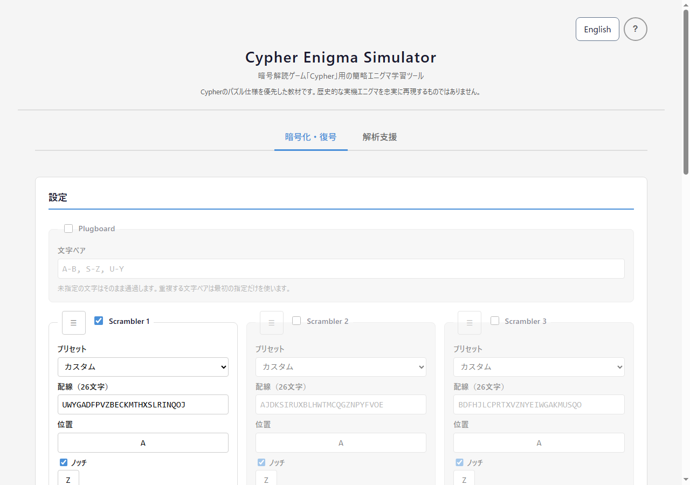
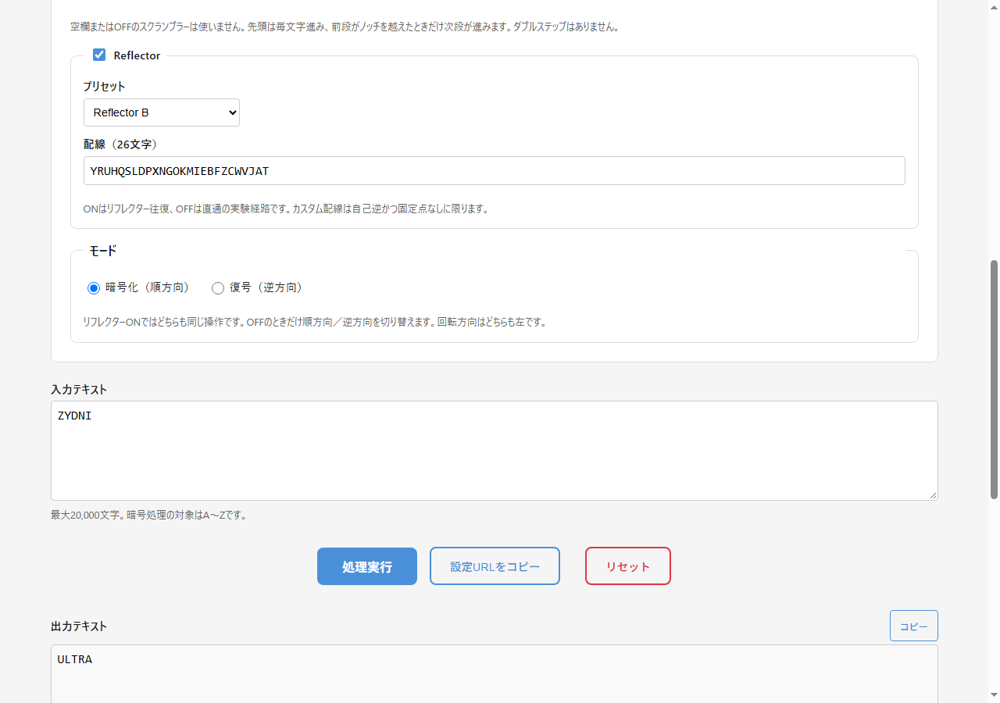

<!--
---
id: day108
slug: cypher-enigma-simulator

title: "Cypher Enigma Simulator"

subtitle_ja: "暗号解読ゲーム「Cypher」用の簡易エニグマシミュレーター"
subtitle_en: "Simplified Enigma simulator for the Cypher puzzle game"

description_ja: "Cypher系パズルの簡略エニグマを再現し、信号経路と初期位置探索を検証する日英対応の学習ツール"
description_en: "A bilingual learning tool for reproducing Cypher-style Enigma puzzles and inspecting signal paths and initial-position searches"

category_ja:
  - 古典暗号
  - 機械式暗号
  - シミュレーター
category_en:
  - Classical Cryptography
  - Mechanised Cryptography
  - Simulator

difficulty: 4

tags:
  - enigma
  - cipher
  - puzzle
  - cryptography
  - vanilla-js
  - simulator

repo_url: "https://github.com/ipusiron/cypher-enigma-simulator"
demo_url: "https://ipusiron.github.io/cypher-enigma-simulator/"

hub: true
---
-->

# Cypher Enigma Simulator - simplified Enigma learning tool for the puzzle game Cypher


[](https://ipusiron.github.io/cypher-enigma-simulator/)

**Day108 - Security Tools with Generative AI 200**

This browser-only learning tool reproduces a Cypher-style Enigma machine and lets you inspect each letter's signal path and search for initial positions.

**Important:** The model follows the Cypher puzzle rules. It is not a faithful historical Enigma simulation: ring settings, double-stepping, and military operating procedures are outside its scope.

[日本語版README](README.md)

---

## 🌐 Demo

👉 **[https://ipusiron.github.io/cypher-enigma-simulator/](https://ipusiron.github.io/cypher-enigma-simulator/)**

The tool runs directly in a browser.

---

## 📸 Screenshots

> 
>
> *Machine settings*

> 
>
> *Processing trace*

---

## ✨ Features

### Encryption and decryption

- Bidirectional plugboard letter pairs
- One to three scramblers with Enigma I-V presets
- Drag, touch, and keyboard reordering
- Configurable notch positions and an odometer-style fallback when a notch is disabled
- Reflector B/C presets and strict validation of custom reflectors
- Explicit separation between a reflector round trip and a reflectorless direct experiment
- Forward encryption and inverse decryption for the direct experiment

### Inspection and utilities

- Per-letter processing trace with the post-step positions and each component transition
- Automatic setting storage in `localStorage`
- Shareable settings URL
- Japanese/English UI with remembered language selection
- Copy controls for output and traces
- Mobile-first layout from 320px and keyboard-accessible controls

### Known-plaintext initial-position search

- Searches the starting positions when wiring and some plaintext letters are known
- Search spaces of 26, 676, or 17,576 combinations for one, two, or three scramblers
- Accepts multiple separated known-plaintext letters
- Shows every matching candidate, its full output, supplied matches, and trace
- Applies a selected candidate to the main tab only after confirmation

The candidates satisfy the supplied conditions. They do not prove the correct answer or recover unknown wiring or a complete historical key.

---

## 📖 Usage

### 1. Configure the machine

1. Enable the plugboard and any scramblers you need.
2. Select a preset or enter a 26-letter permutation.
3. Enter each starting position from A to Z.
4. Configure the simplified notch behaviour if needed.
5. Keep the reflector on for the Cypher/Enigma-style round trip, or turn it off for the direct experiment.
6. Reorder scramblers with the handle, touch dragging, or arrow keys.

### 2. Process text

1. Enter up to 20,000 characters.
2. Select **Process**.
3. Inspect both the output and the per-letter trace.

Only A-Z letters are transformed. Spaces, digits, punctuation, and other characters pass through without advancing the scramblers.

### 3. Search from known plaintext

1. Open **Analysis aid**.
2. Enter the known plugboard, scrambler, and reflector settings.
3. Enter up to 200 ciphertext characters.
4. Fill in only the plaintext letters whose positions are known.
5. Select **Run search** and compare the candidates.

---

## 🔬 Signal paths

### Reflector on

```text
Input → Plugboard → Scrambler (1→2→3) → Reflector → Scrambler (3→2→1) → Plugboard → Output
```

A valid reflector is self-inverse and fixed-point-free. With identical starting settings, the same operation encrypts and decrypts. The mode labels describe the user's intent; the path and leftward stepping are the same.

### Reflector off: direct experiment

```text
Encrypt: Input → Plugboard → Scrambler (1→2→3) → Plugboard → Output
Decrypt: Input → Plugboard → inverse Scrambler (3→2→1) → Plugboard → Output
```

The first scrambler advances left before every processed letter in both modes. Decryption reverses the signal path instead of reversing the stepping direction, so the same initial settings make the two operations inverses. This direct path is a teaching experiment, not a historical Enigma configuration.

---

## 🔔 Simplified stepping and notches

- The first active scrambler advances before every A-Z letter.
- If its previous position equals the configured notch, crossing to the next letter advances the following scrambler.
- With a notch disabled, the following scrambler advances on the Z-to-A wrap.
- The cascade can continue through the third scrambler.
- Historical double-stepping is not simulated.

For example, a first scrambler at C with notch C moves to D before the next letter is processed, and the second scrambler advances from A to B.

---

## ⚙️ Bundled wirings

### Scramblers

| Name | Wiring |
|---|---|
| Enigma I | `EKMFLGDQVZNTOWYHXUSPAIBRCJ` |
| Enigma II | `AJDKSIRUXBLHWTMCQGZNPYFVOE` |
| Enigma III | `BDFHJLCPRTXVZNYEIWGAKMUSQO` |
| Enigma IV | `ESOVPZJAYQUIRHXLNFTGKDCMWB` |
| Enigma V | `VZBRGITYUPSDNHLXAWMJQOFECK` |

### Reflectors

| Name | Wiring |
|---|---|
| Reflector B | `YRUHQSLDPXNGOKMIEBFZCWVJAT` |
| Reflector C | `FVPJIAOYEDRZXWGCTKUQSBNMHL` |

Custom reflector wiring must contain A-Z exactly once, map every letter back to itself after two applications, and contain no fixed point.

---

## 🎯 Use cases

### Uses specific to this tool

- **Trace the Cypher Puzzle 01 vector:** set scrambler wiring to `UWYGADFPVZBECKMTHXSLRINQOJ`, start at A, use Reflector B, and follow all five transitions from `ZYDNI` to `ULTRA`.
- **Observe the reflector invariant:** process `ULTRA → ZYDNI → ULTRA` with identical settings and see why the reflector path uses the same operation in both directions.
- **Compare a direct inverse:** disable the reflector and verify that forward encryption and inverse decryption return to the original text.
- **Inspect a notch boundary:** start the first scrambler at C with notch C and see the second scrambler move from A to B as the first crosses C to D.
- **Narrow initial positions from a crib:** search 26, 676, or 17,576 initial-position combinations and inspect why each returned candidate matched.

### Cypher walkthroughs

- [MECHANISED CRYPTOGRAPHY PUZZLE 01 (Cypher)](https://akademeia.info/?p=36324)
- [MECHANISED CRYPTOGRAPHY PUZZLE 02 (Cypher)](https://akademeia.info/?p=36348)
- [MECHANISED CRYPTOGRAPHY PUZZLE 03 (Cypher)](https://akademeia.info/?p=36372)

The tool also works as a compact teaching aid for permutations, inverse mappings, odometer-style stepping, custom-wiring validation, and trace-based implementation comparison.

---

## ⚠️ Limits

- No ring settings
- No historical double-step
- No faithful military Enigma operating procedure or machine variant
- No claim that a known-plaintext candidate is the unique or historically correct key
- No security use: this is an educational classical-cipher simulator

---

## 🔧 Local use and tests

```bash
git clone https://github.com/ipusiron/cypher-enigma-simulator.git
cd cypher-enigma-simulator

# Open index.html directly, or use any static HTTP server.

npm test
```

No third-party package is required.

---

## 📁 Directory structure

```text
cypher-enigma-simulator/
├── index.html              # Main page
├── style.css               # Responsive styles
├── logic.js                # DOM-independent cipher core
├── messages.js             # Japanese and English UI messages
├── main.js                 # UI, persistence, and position search
├── README.md               # Japanese documentation
├── README.en.md            # This document
├── LICENSE                 # MIT License
├── package.json            # Node.js test command
├── .github/workflows/
│   └── test.yml            # Test workflow for push and pull requests
├── test/
│   ├── core.test.js        # Vectors, round trips, stepping, validation
│   └── ui-contract.test.js # Bilingual UI, CSP, responsive contracts
├── assets/                 # Screenshots
└── docs/
    ├── UI_SPEC.md          # UI specification
    └── DETAILED_SPEC.md    # Detailed behaviour
```

---

## 📄 License

See [LICENSE](LICENSE).

---

## 🛠️ About this project

This tool is part of the “Security Tools with Generative AI 200” project, which builds and publishes security-related learning tools with AI assistance over 100 days.

See the project page for the other tools:

🔗 [https://akademeia.info/?page_id=44607](https://akademeia.info/?page_id=44607)
