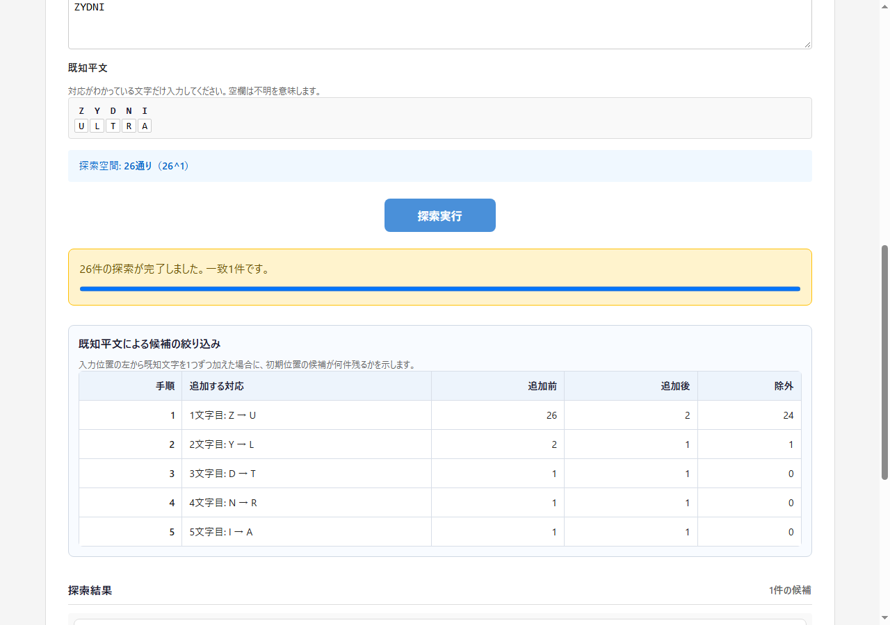
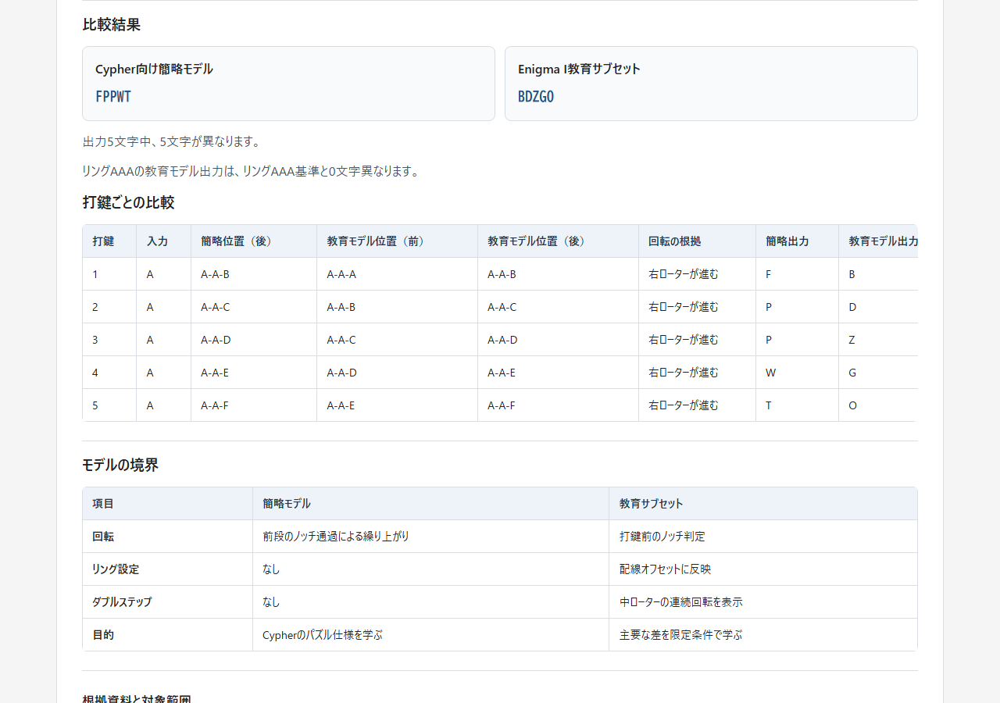

<!--
---
id: day108
slug: cypher-enigma-simulator

title: "Cypher Enigma Simulator"

subtitle_ja: "暗号解読ゲーム「Cypher」用の簡易エニグマシミュレーター"
subtitle_en: "Simplified Enigma simulator for the Cypher puzzle game"

description_ja: "Cypher系パズルの簡略エニグマを再現し、信号経路・初期位置探索・Enigma I教育サブセットとの差を検証する日英対応の学習ツール"
description_en: "A bilingual tool for studying Cypher-style Enigma puzzles, initial-position searches, and differences from an Enigma I educational subset"

category_ja:
  - 古典暗号
  - 機械式暗号
  - シミュレーター
category_en:
  - Classical Cryptography
  - Mechanised Cryptography
  - Simulator

difficulty: 4

tags:
  - enigma
  - cipher
  - puzzle
  - cryptography
  - vanilla-js
  - simulator

repo_url: "https://github.com/ipusiron/cypher-enigma-simulator"
demo_url: "https://ipusiron.github.io/cypher-enigma-simulator/"

hub: true
---
-->

# Cypher Enigma Simulator – 暗号解読ゲーム「Cypher」用の簡易エニグマシミュレーター


[](https://ipusiron.github.io/cypher-enigma-simulator/)

**Day108 - 生成AIで作るセキュリティツール200**

Cypherで使用されるエニグマ風暗号機を再現し、文字ごとの信号経路と初期位置探索を確認するための学習ツールです。すべての処理はブラウザー内で完結します。

**注意**: 暗号化・復号タブはCypherのパズル仕様を優先した簡略モデルです。モデル比較タブではリング設定とダブルステップを含むEnigma I教育サブセットとの差を確認できますが、軍用機の運用手順を含む完全な実機再現ではありません。

---

## 🌐 デモページ

👉 **[https://ipusiron.github.io/cypher-enigma-simulator/](https://ipusiron.github.io/cypher-enigma-simulator/)**

ブラウザーで直接お試しいただけます。

---

## 📸 スクリーンショット

> 
>
> *各種セッティング*

> 
>
> *復号時の内部状態*

> 
>
> *進捗と既知文字ごとの候補減少を確認できる初期位置探索*

> 
>
> *既知ベクトル、リング設定、ダブルステップを打鍵単位で比較*

---

## ✨ 主な機能

### 暗号化・復号
- プラグボード（文字ペア置換）
- スクランブラー 1〜3枚（プリセット: Enigma I〜V）
- スクランブラーのドラッグ&ドロップ並び替え
- ノッチ機能（カスケード回転制御、ON/OFF切替可能）
- リフレクター（プリセット: Reflector B/C、カスタム配線の自己逆性と固定点を検査）
- リフレクター往復と、リフレクターなしの直通実験を明示的に分離
- 直通実験では暗号化を順方向、復号を逆方向として処理
- リアルタイム処理

### 可視化
- 内部状態ログ（各文字の処理過程を表示）
- 信号が通ったコンポーネントと入出力文字を段階表示
- スクランブラーの回転後位置を表示
- ノッチ状態の表示（ON時は位置、OFF時は「OFF」）

### ユーティリティ
- 設定の自動保存（localStorage）
- URL共有（設定をURLパラメーター化）
- 入力バリデーション
- コピー機能（出力・ログ）
- 日本語／英語の画面切り替えと言語設定の保存
- 320pxからのモバイル表示とキーボードによる並び替え

### 解析支援：既知平文攻撃
- 暗号文と既知平文の一部からスクランブラー初期位置を探索
- 26^n通りの総当たり探索（1枚: 26、2枚: 676、3枚: 17,576通り）
- 複数の断片的な既知平文に対応
- 64通りずつ処理する非同期探索、進捗表示、途中キャンセル
- 既知文字を左から追加したときの候補数と除外数を表で比較
- 一致件数は全件を数え、画面表示は先頭100件に制限
- 候補の処理トレースは詳細を開いたときだけ生成
- 候補を暗号化・復号タブに適用する機能

### モデル比較

- Cypher向け簡略モデルとEnigma I教育サブセットを同じ条件で比較
- ローターI〜V、反射板B/C、開始位置、リング設定を選択
- 既知ベクトル`AAAAA → BDZGO`をワンクリックで再現
- `ADU → ADV → AEW → BFX`の位置遷移で中ローターのダブルステップを表示
- 打鍵前後の位置、回転理由、両モデルの出力を表で比較
- 選択したリング設定とAAA基準の出力差を件数表示

---

## 📖 使い方

### 1. 設定

1. 必要に応じてPlugboard、Scrambler 2/3をONにする
2. プリセットを選択するか、配線を直接入力（26文字）
3. 開始位置を指定（A-Z）
4. 必要に応じてノッチ設定を調整（詳細は後述）
5. リフレクターONでは暗号化・復号のどちらを選んでも同じ往復操作になることを確認する。OFFの直通実験では暗号化（順方向）または復号（逆方向）を選択
6. スクランブラーの順序を変更したい場合は、ドラッグハンドル（☰）をドラッグして並び替え

### 2. 処理

1. 入力テキスト欄にテキストを入力
2. 「処理実行」ボタンをクリック（またはリアルタイム処理を待つ）
3. 出力テキストと内部状態ログを確認

### 3. 共有

「設定URLをコピー」ボタンで現在の設定をURL化してコピー。リンクを共有すれば、同じ設定を再現可能。

### 4. 既知平文攻撃（解析支援タブ）

スクランブラーの配線はわかっているが、初期位置が不明な場合に使用します。

1. 「解析支援」タブを選択
2. プラグボード、スクランブラー配線、リフレクターを設定
3. 暗号文を入力（自動的に既知平文グリッドが生成される）
4. 既知平文グリッドで、わかっている文字を対応する位置に入力（空欄は「不明」を意味）
5. 「探索実行」ボタンをクリックし、確認済み件数・全件数・一致件数を確認。必要なら「探索を中止」で止める
6. 絞り込み表で、既知文字を1つ加えるたびに候補が何件除外されたかを比較
7. 候補の詳細を開いて処理トレースを生成する
8. 候補が見つかったら「設定に適用」ボタンで暗号化・復号タブに反映

### 5. モデル比較

1. 「モデル比較」タブを選択
2. 「既知ベクトル（AAAAA）」で、ローターI-II-III、開始位置AAA、リングAAA、反射板Bの結果`BDZGO`を確認
3. 「ダブルステップ例（ADU）」で、教育サブセットの位置が`ADV → AEW → BFX`と変化することを確認
4. ローター、開始位置、リング、反射板、40文字以内の入力を変更し、「比較する」を選択
5. 出力差、AAAリング基準との差、打鍵ごとの位置と回転理由を確認

比較用モデルにはプラグボードがなく、日鍵・通信鍵などの運用手順も再現しません。歴史的な機械全体ではなく、簡略モデルとの差を観察するための限定された教材です。

---

## 🔬 暗号処理フロー

### リフレクターON

```
入力 → Plugboard → Scrambler(1→2→3) → Reflector → Scrambler(3→2→1) → Plugboard → 出力
```

自己逆なリフレクターを使うため、同じ初期設定と同じ操作で暗号化と復号を行えます。画面のモード表示は処理目的を示しますが、信号経路と左方向の回転は同じです。

### リフレクターOFF（直通実験）

```text
暗号化: 入力 → Plugboard → Scrambler(1→2→3) → Plugboard → 出力
復号:   入力 → Plugboard → Scrambler(3→2→1 の逆配線) → Plugboard → 出力
```

各文字の処理前に先頭のスクランブラーを左へ1文字進めます。復号時も回転方向は変えず、信号の通過方向を逆にすることで同じ初期位置から往復できます。この直通経路は学習用の実験であり、歴史的エニグマの構成ではありません。

---

## 🔔 ノッチ機能の詳細

ノッチは、スクランブラーのカスケード回転（連動回転）を制御する機構です。

### 基本概念

エニグマ暗号機では、複数のスクランブラーが連動して回転します。通常、1番目のスクランブラーは毎文字処理前に1回転しますが、2番目以降のスクランブラーは「ノッチ」の条件を満たしたときだけ回転します。

### 仕組み

各スクランブラーには「ノッチ位置」を設定できます：

| 設定 | 動作 |
|------|------|
| ノッチON（例: Z） | 前段スクランブラーが設定位置を超えたとき、次段が1回転 |
| ノッチOFF | 前段スクランブラーが26回回転するごとに、次段が1回転（Z→A時に発動） |

**重要**: ノッチは「そのスクランブラー自身」ではなく「次のスクランブラー」の回転タイミングを決定します。

### ノッチの効果

| スクランブラー位置 | ノッチの効果 |
|-------------------|-------------|
| 1番目 | 2番目のスクランブラーがいつ回転するかを決定 |
| 2番目 | 3番目のスクランブラーがいつ回転するかを決定 |
| 3番目（最後） | 効果なし（後続のスクランブラーがないため） |

### 具体例

**設定**: Scrambler 1のノッチ = C（ON）、初期位置 = A

**暗号化時の動作**:

| 処理文字 | Scrambler 1 位置 | Scrambler 2 動作 |
|----------|-----------------|------------------|
| 1文字目 | A → B | 回転しない |
| 2文字目 | B → C | 回転しない |
| 3文字目 | C → D | **ここで1回転**（ノッチ位置Cを超えた） |
| 4文字目 | D → E | 回転しない |
| ... | ... | ... |

つまり、ノッチ=Cの場合、Scrambler 1が C→D に変化するタイミングで Scrambler 2 が回転します。

### ノッチOFFの場合

ノッチをOFFにすると、従来の26回転で1回カスケードする動作になります。これは実質的に「ノッチ=Z」と同等ですが、明示的にノッチ機能を無効化したい場合に使用します。

### 復号時の注意

リフレクターの有無にかかわらず、先頭スクランブラーは毎文字の処理前に左へ進みます。直通実験の復号では回転を逆にせず、スクランブラーを末尾から逆配線でたどります。

---

### 既知平文攻撃のアルゴリズム

```
1. 有効なスクランブラー数 n を取得
2. 26^n 通りの初期位置を64通りずつ調べ、各バッチの間で画面操作を受け付ける
3. 既知文字を入力位置の左から順に照合し、各段階で残る候補数を集計
4. すべての既知文字と一致した初期位置を候補として数える
5. 正確な一致件数を示し、画面負荷を抑えるため先頭100件だけをリスト表示
6. 候補の処理トレースは詳細を開いた時点で生成
```

探索を中止した場合は、確認済みの組み合わせだけを母集団とする途中結果であることを明示します。候補の並びや件数は暗号学的な確率・信頼度・正解率を意味しません。

---

## ⚙️ プリセット配線

### スクランブラー

| 名称 | 配線 |
|------|------|
| Enigma I | EKMFLGDQVZNTOWYHXUSPAIBRCJ |
| Enigma II | AJDKSIRUXBLHWTMCQGZNPYFVOE |
| Enigma III | BDFHJLCPRTXVZNYEIWGAKMUSQO |
| Enigma IV | ESOVPZJAYQUIRHXLNFTGKDCMWB |
| Enigma V | VZBRGITYUPSDNHLXAWMJQOFECK |

### リフレクター

| 名称 | 配線 |
|------|------|
| Reflector B | YRUHQSLDPXNGOKMIEBFZCWVJAT |
| Reflector C | FVPJIAOYEDRZXWGCTKUQSBNMHL |

---

## ⚠️ 非対応事項

以下は意図的に省略しています。

- 暗号化・復号タブでのリング設定とダブルステップ
- モデル比較タブでのプラグボード
- 軍用エニグマ仕様の完全再現
- リング設定を含む史料上の鍵手順や運用の再現

既知平文による探索結果は、入力した配線と既知文字に一致する初期位置の候補です。正解、鍵全体の復元、未知配線の解読を証明するものではありません。

---

## 🎯 ユースケース

### このツールならではの使い方

- **Cypher PUZZLE 01の既知ベクトルを追跡する**: カスタムスクランブラー`UWYGADFPVZBECKMTHXSLRINQOJ`、開始位置A、Reflector Bで`ZYDNI`を処理し、`ULTRA`になる5文字の経路を確認
- **リフレクターの自己逆性を確かめる**: 同じ設定で`ULTRA → ZYDNI → ULTRA`と往復し、リフレクターありでは暗号化と復号が同じ操作になる理由を学習
- **直通経路の逆変換を比較する**: リフレクターをOFFにし、順方向の暗号化と逆方向の復号が互いに逆変換であることを確認
- **ノッチ境界を観察する**: 先頭のノッチをC、開始位置をCにして1文字処理し、C→Dで次段がA→Bへ進むことをトレースで確認
- **既知平文から初期位置を絞る**: スクランブラー1枚なら26通り、2枚なら676通り、3枚なら17,576通りを探索し、一致候補と根拠を比較

### ゲーム「Cypher」の暗号文を検証する

- [MECHANISED CRYPTOGRAPHY PUZZLE 01【Cypher編】](https://akademeia.info/?p=36324)
- [MECHANISED CRYPTOGRAPHY PUZZLE 02【Cypher編】](https://akademeia.info/?p=36348)
- [MECHANISED CRYPTOGRAPHY PUZZLE 03【Cypher編】](https://akademeia.info/?p=36372)

このほか、置換・逆写像・オドメーター式回転を学ぶ教材、カスタム配線の妥当性検査、処理トレースを使った実装比較にも利用できます。

---

## 📚 モデル比較の根拠資料

比較タブのローター配線・ノッチ・リング設定・ダブルステップは、次の史料と研究資料を基にしています。

- [H.Dv.g. 14: Schlüsselanleitung zur Schlüsselmaschine Enigma (1940)](https://enigma.3d.pl/files/enigma-manual1940-german.pdf)
- [NSA: Introduction to Cryptology, Part VI](https://www.nsa.gov/portals/75/documents/news-features/declassified-documents/friedman-documents/lectures-speeches/FOLDER_179/41758629079776.pdf)
- [NSA Cryptographic Mathematics: Enigma Wiring](https://www.cryptomuseum.com/crypto/enigma/files/enigma_wiring_catalog.pdf)
- [David H. Hamer: Enigma: Actions Involved in the Double Stepping of the Middle Rotor](https://www.cryptomuseum.com/people/hamer/files/double_stepping.pdf)

これらを参照して主要な差を再現していますが、機種差、プラグボード、鍵配布、メッセージ手順を網羅する実機エミュレーターではありません。

---

## 🔧 ローカル実行

```bash
# クローン
git clone https://github.com/ipusiron/cypher-enigma-simulator.git
cd cypher-enigma-simulator

# ブラウザーで開く
open index.html  # macOS
start index.html # Windows

# テスト
npm test
```

---

## 📁 ディレクトリー構造

```
cypher-enigma-simulator/
├── index.html          # メインHTMLファイル
├── style.css           # スタイルシート
├── logic.js            # DOMに依存しない暗号コア
├── attack-core.js      # 分割探索・候補集計・絞り込み計算
├── comparison-core.js  # Enigma I教育サブセットとモデル比較
├── messages.js         # 日本語・英語の表示文言
├── main.js             # UI・保存・初期位置探索・モデル比較
├── README.md           # 本ドキュメント
├── README.en.md        # 英語版ドキュメント
├── LICENSE             # MITライセンス
├── package.json        # Node.jsテスト定義
├── .gitignore          # Git除外設定
├── .nojekyll           # GitHub Pages用
├── .github/workflows/
│   └── test.yml        # push・pull_request時の自動テスト
├── test/
│   ├── attack-core.test.js # 分割探索・候補上限・絞り込みのテスト
│   ├── comparison-core.test.js # 既知ベクトル・リング・ダブルステップのテスト
│   ├── core.test.js    # 既知ベクトル・往復性・検証のテスト
│   └── ui-contract.test.js # 日英UI・CSP・モバイル契約のテスト
├── assets/             # screenshot1.png〜screenshot4.png
└── docs/
    ├── UI_SPEC.md      # 画面仕様書
    └── DETAILED_SPEC.md # 詳細仕様書
```

---

## 📄 ライセンス

- ソースコードのライセンスは `LICENSE` ファイルを参照してください。

---

## 🛠️ このツールについて

本ツールは、「生成AIで作るセキュリティツール200」プロジェクトの一環として開発されました。
このプロジェクトでは、AIの支援を活用しながら、セキュリティに関連するさまざまなツールを100日間にわたり制作・公開していく取り組みを行っています。

プロジェクトの詳細や他のツールについては、以下のページをご覧ください。

🔗 [https://akademeia.info/?page_id=44607](https://akademeia.info/?page_id=44607)
